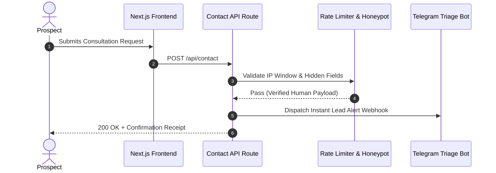

# B2B IT Consultancy & Lead Generation Engine (Architecture & Specs)

> **Live Platform:** [tfsdigital.co.uk](https://www.tfsdigital.co.uk)  
> **Architected & Engineered by:** Gurpreet Bhamra ([TFS Digital](https://www.tfsdigital.co.uk))  
> **Repository Scope:** Public Architecture & Automation Showcase (Commercial Source Code Private)

---

## Executive Overview

An enterprise consultancy platform engineered for technical lead qualification, interactive project scoping, and automated triage routing. Built with serverless edge validation, deterministic bot mitigation, and sub-2-second alert dispatching.

### Key Performance & Quality Metrics
* **Lead Triage Latency:** Automated Telegram alert push and transactional confirmation in <2s
* **Spam & Bot Mitigation:** Zero-captcha honeypot traps paired with IP sliding-window rate limiting
* **Availability & Core Web Vitals:** 99.99% edge uptime with 100 Accessibility & SEO Lighthouse scores

---

## Tech Stack & Infrastructure

* **Framework:** Next.js (App Router), React, Tailwind CSS, TypeScript
* **Automations & Routing:** Telegram Bot API Webhooks, Resend Transactional Email
* **Quality Assurance & SEO:** Playwright API & E2E validation, Schema.org JSON-LD structured data
* **Deployment:** Vercel Enterprise Edge Network

---

## System Sequence Diagram



---

## Core Technical Features Showcase

1. **Serverless Honeypot & Rate Limiting:** Custom request middleware shielding public intake routes from automated bot submissions without degrading user friction with CAPTCHAs.
2. **Instant Lead Triage Webhook:** Real-time Telegram integration formatting and escaping MarkdownV2 payloads to notify engineering leads within seconds of submission.
3. **Structured Search Engine Optimization:** Dynamic JSON-LD schema injection for technical consulting services and case study rich snippets.

---

## Repository Structure

```text
├── README.md
├── docs/
│   └── LEAD_TRIAGE_WORKFLOW.md
└── samples/
    ├── rate-limiter-middleware.ts
    └── lead-triage-telegram.ts
```
